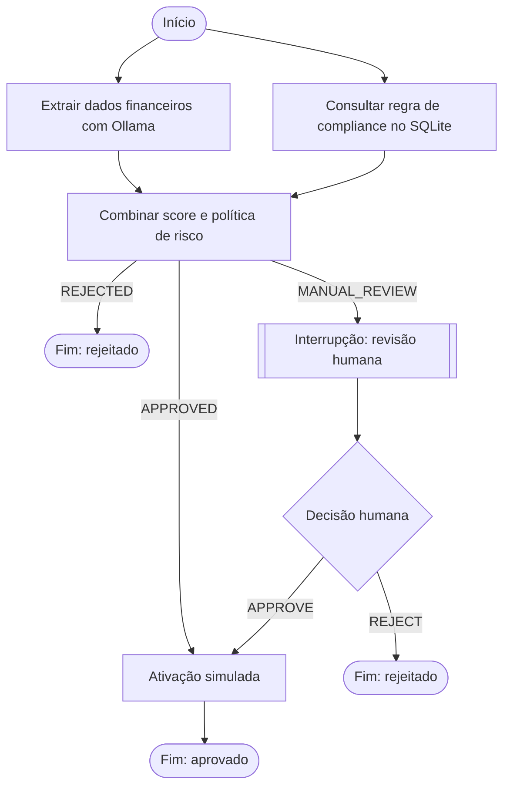

tests/                                  Testes sem dependência do servidor Ollama
# Onboarding B2B com LangGraph


## Visão geral

Projeto de estudo sobre orquestração de agentes e workflows com LangGraph. A API recebe os dados de uma empresa e um arquivo de texto financeiro; um LLM local extrai os campos financeiros enquanto outro ramo consulta regras de risco no SQLite. O grafo combina os resultados e, quando necessário, pausa para uma decisão humana.

O projeto reúne conceitos de LangGraph, FastAPI, Ollama, Pydantic, SQLAlchemy, SQLite, Alembic, persistência de checkpoints e testes com dependências injetadas. A consulta de crédito e a ativação no CRM são simuladas; não há integração com bureau ou CRM real.

## O que este projeto permite estudar

- Como modelar estado compartilhado com `TypedDict` e mensagens do LangGraph.
- Como executar nós em paralelo e sincronizar resultados em um join.
- Como usar arestas condicionais para decidir os próximos passos do workflow.
- Como interromper o grafo para revisão humana e retomar de um checkpoint.
- Como solicitar saídas estruturadas de um modelo local usando Pydantic.
- Como separar rotas HTTP, serviços, agente/grafo, models e repositories.
- Como persistir estado do negócio e checkpoints em SQLite.
- Como validar regras de domínio, versionar o schema e testar sem chamar um LLM real.

## Pré-requisitos

- Python 3.10 ou superior.
- [Ollama](https://ollama.com/) instalado e em execução.
- O modelo local `qwen2.5:3b`, ou outro configurado em `.env`.

Baixe o modelo padrão:

```powershell
ollama pull qwen2.5:3b
```

## Instalação

Na raiz do projeto, crie e ative o ambiente virtual e instale as dependências:

```powershell
python -m venv .venv
.\.venv\Scripts\Activate.ps1
pip install -r requirements.txt
pip install -r requirements-dev.txt
```

Crie a configuração local a partir do exemplo:

```powershell
Copy-Item .env.example .env
```

Edite `.env` caso o Ollama, o modelo ou os caminhos locais sejam diferentes dos padrões:

| Variável | Padrão | Descrição |
| --- | --- | --- |
| `HOST` | `127.0.0.1` | Endereço em que a API escuta |
| `PORT` | `8000` | Porta HTTP |
| `LOG_LEVEL` | `INFO` | Nível dos logs |
| `OLLAMA_URL` | `http://127.0.0.1:11434` | URL do servidor Ollama |
| `OLLAMA_MODEL` | `qwen2.5:3b` | Modelo usado na extração estruturada |
| `OLLAMA_TIMEOUT` | `180` | Timeout da chamada ao modelo, em segundos |
| `MAX_FILE_SIZE_BYTES` | `10485760` | Tamanho máximo do upload (10 MiB) |
| `ONBOARDING_DATABASE` | `data/onboarding.sqlite3` | SQLite para regras, solicitações e checkpoints |
| `ONBOARDING_FILES_DIR` | `data/onboarding_files` | Diretório local dos arquivos recebidos |

## Executar a API

Com o ambiente ativado:

```powershell
python main.py
```

A API estará em `http://127.0.0.1:8000`; o Swagger interativo fica em [`/docs`](http://127.0.0.1:8000/docs). O Ollama precisa estar acessível para processar novos documentos.

## Fluxo LangGraph



O ramo de extração usa `with_structured_output` com o schema `FinancialExtraction`. Campos que não aparecem no documento podem ser retornados como `null`; o modelo recebe instruções para não estimar dados ausentes.

O ramo de compliance consulta regras cadastradas em `credit_bureau_rules`. O supervisor consulta `risk_policies`; essas faixas são dados estruturados e ficam no SQLite, em vez de serem inferidas pelo LLM.

| Sufixo do CNPJ | Score de risco simulado | Resultado esperado |
| --- | ---: | --- |
| `0001` | 15 | Aprovação e ativação simulada |
| `0002` | 55 | Pausa para revisão humana |
| `0003` | 90 | Rejeição |

As políticas iniciais aprovam scores de `0–39`, enviam `40–70` para revisão e rejeitam `71–100`. A integridade das faixas é validada no bootstrap para evitar lacunas ou sobreposições.

## Rotas da API

| Método | Endpoint | Descrição |
| --- | --- | --- |
| `GET` | `/health` | Verifica disponibilidade |
| `POST` | `/onboardings` | Cria onboarding com multipart `company_name`, `cnpj` e `file` |
| `GET` | `/onboardings/{onboarding_id}` | Consulta status e resultados |
| `POST` | `/onboardings/{onboarding_id}/decision` | Envia `APPROVE` ou `REJECT` e retoma o grafo |

### Criar solicitação

O arquivo deve ser texto UTF-8. O CNPJ deve conter 14 dígitos; pode ser enviado formatado ou sem pontuação. Este exemplo termina em `0002`, portanto aguarda revisão:

```powershell
curl.exe -X POST "http://127.0.0.1:8000/onboardings" `
	-F "company_name=Acme Tecnologia Ltda." `
	-F "cnpj=12.345.678/0100-02" `
	-F "file=@balanco.txt;type=text/plain"
```

A resposta inclui um `onboarding_id`, status, score, alertas e dados financeiros extraídos. Guarde o identificador para consultar ou decidir uma revisão.

### Consultar e decidir

```powershell
curl.exe "http://127.0.0.1:8000/onboardings/ONBOARDING_ID"
```

Quando `paused_for_review` for `true`, envie a decisão:

```powershell
curl.exe -X POST "http://127.0.0.1:8000/onboardings/ONBOARDING_ID/decision" `
	-H "Content-Type: application/json" `
	-d '{"decision":"APPROVE"}'
```

Use `REJECT` para rejeitar. A API retorna `409` se o onboarding não estiver aguardando revisão e `404` para um identificador inexistente.

## Persistência e migrações

O SQLAlchemy mapeia três tabelas, com um model e um repository por tabela:

- `credit_bureau_rules`: score e alertas da consulta simulada.
- `risk_policies`: faixas de score e status resultante.
- `onboarding_requests`: dados da empresa, arquivo, resultados e decisão humana.

O arquivo recebido é armazenado em `data/onboarding_files/{onboarding_id}/`. O banco e o checkpointer SQLite do LangGraph usam o caminho configurado em `ONBOARDING_DATABASE`, permitindo retomar revisões após reiniciar o processo.

Alembic gerencia o schema relacional. O startup aplica migrações e insere regras de exemplo apenas quando ainda não existem. Para criar uma migração depois de alterar os models:

```powershell
python -m alembic revision --autogenerate -m "descricao da alteracao"
python -m alembic upgrade head
```

Um SQLite legado compatível é adotado pela revisão inicial; um banco parcial é recusado para evitar alterações destrutivas.

## Testes

Os testes usam um extrator fake e bancos/checkpoints temporários, sem precisar iniciar o Ollama:

```powershell
python -m pytest -q
```

A suíte cobre os limites `39`, `40`, `70` e `71`, detecção de faixa sobreposta ou incompleta, validação de CNPJ, pausa/retomada humana, injeção do banco e persistência após recriar o manager/checkpointer.

## Limitações e próximos passos

- O endpoint recebe texto UTF-8, PDF e documento digitalizado precisam de extração de texto/OCR.
- O bureau e a ativação CRM são simulados.
- A API ainda não inclui autenticação, não deve ser exposta publicamente com dados reais.
- O arquivo é enviado ao modelo configurado, é preciiso confirmar que o Ollama é local caso os dados não puderem sair da máquina.

Nção ampliei o escopo pois assim já é suficiente para estudar os principais conceitos de LangGraph. Se há a necessidade de evolução, recomendaria adicionar autenticação/autoria da decisão, avaliar a qualidade da extração com documentos de referência e experimentar RAG para políticas não estruturadas.
